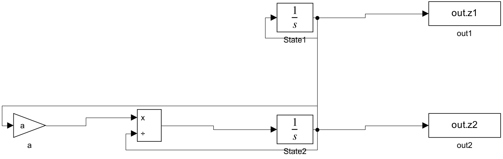
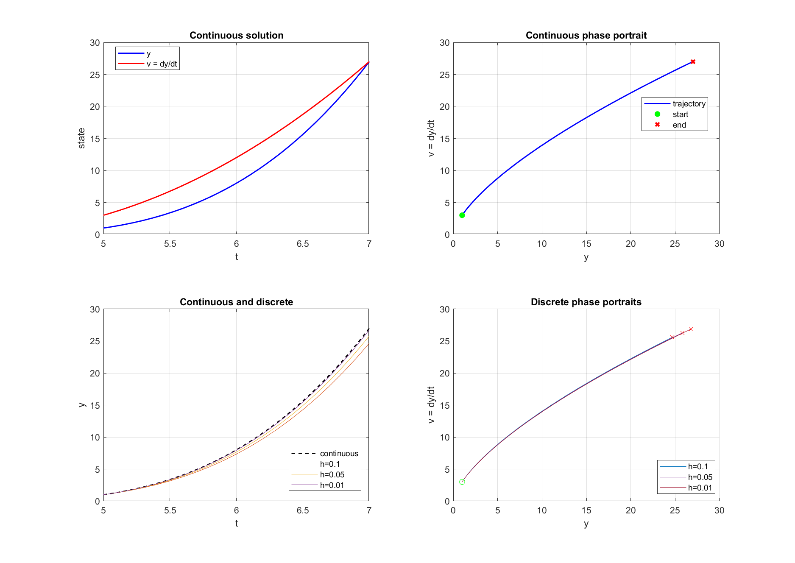
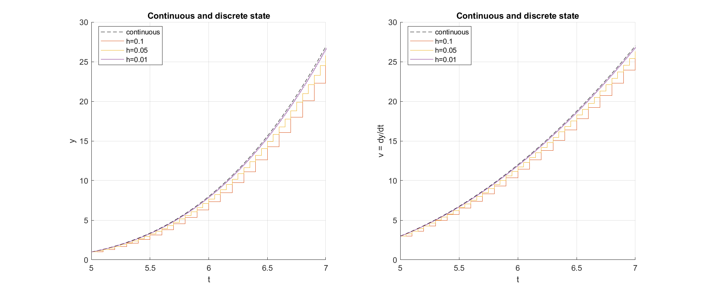
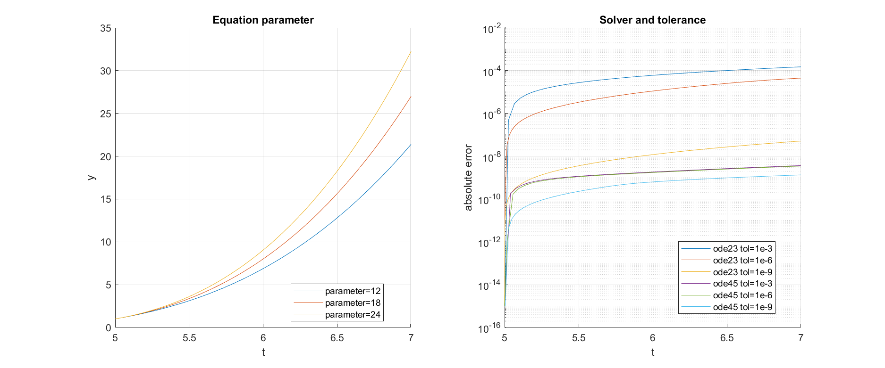
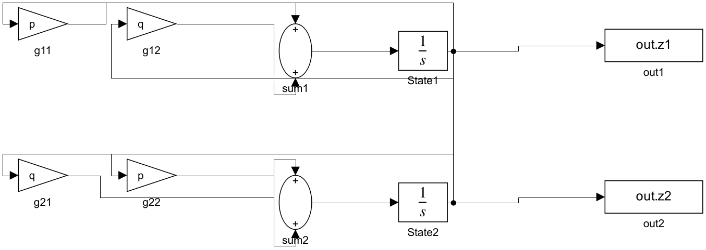
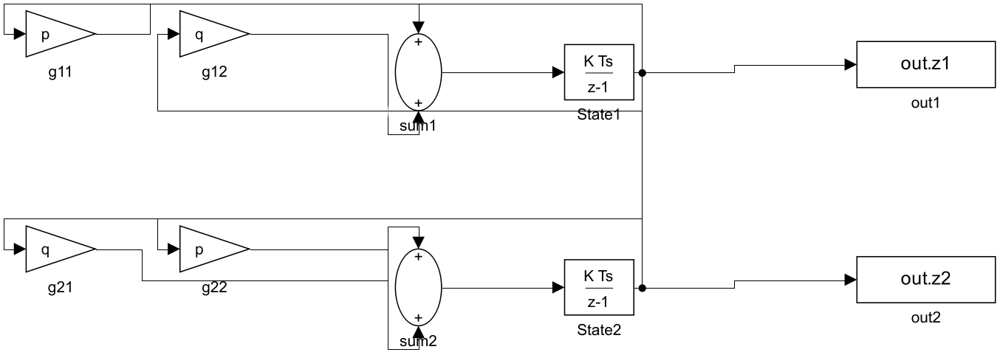
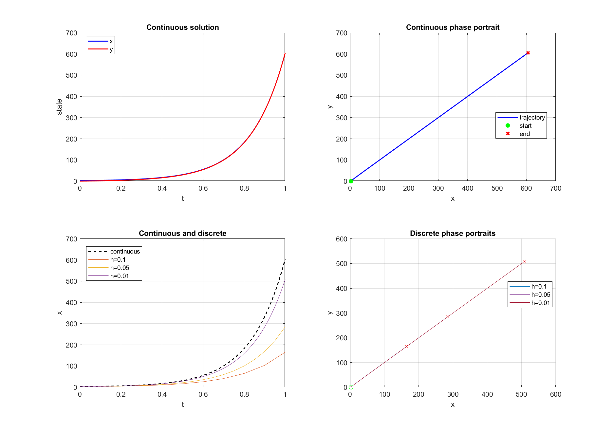
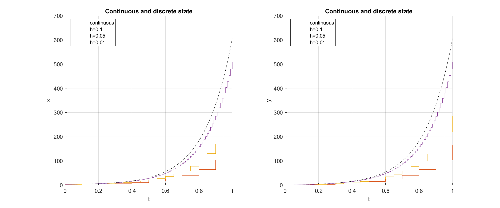
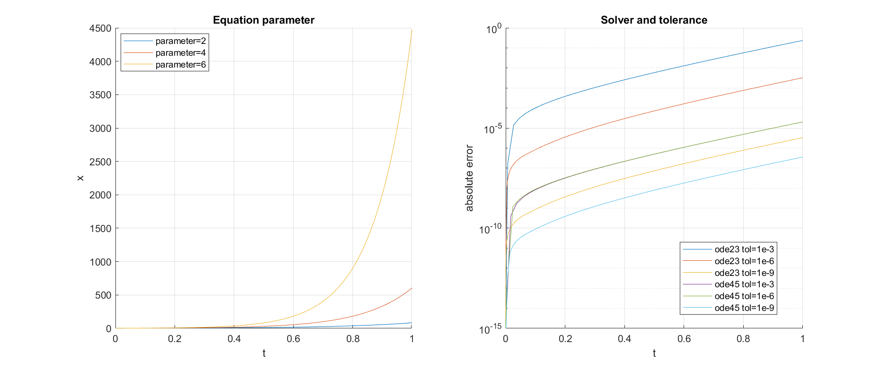

# Лабораторная работа 4

## Моделирование непрерывных и дискретных систем, описываемых дифференциальными и разностными уравнениями

**Вариант 20**

### Цель работы

Освоить моделирование непрерывных процессов и их дискретных аналогов, сравнить решения и оценить погрешность дискретизации.

### Исходные данные

1. y″y′ = 18y, y(5) = 1, y′(5) = 3.
2. x′ = 2x + 4y, y′ = 4x + 2y, x(0) = 3, y(0) = 0.

Интервалы моделирования методическими указаниями не заданы. Для расчета приняты [5; 7] в первом задании и [0; 1] во втором. Шаги дискретизации h = 0,1; 0,05; 0,01.

### 1. Нелинейное уравнение второго порядка

Обозначим v = y′. При v ≠ 0 исходное уравнение эквивалентно системе y′ = v, v′ = 18y/v, y(5) = 1, v(5) = 3. Для непрерывной схемы нужны два интегратора с начальными значениями 1 и 3, усилитель с коэффициентом 18 и блок деления. Выход v подается на вход интегратора y и в знаменатель, выход y — через усилитель в числитель.

**Описание непрерывной схемы.** Блок `State1` интегрирует сигнал v и формирует y; его начальное значение равно 1. Блок `State2` интегрирует 18y/v и формирует v, его начальное значение равно 3. Блок `a` умножает y на 18; блок `Divide` делит результат на v. Выходы состояний записываются блоками `out1` и `out2` в рабочее пространство. Моделирование начинается при t = 5 и заканчивается при t = 7.

На рассматриваемом интервале v положительна. Точное решение: y(t) = (t − 4)³, v(t) = 3(t − 4)². Подстановка дает y″y′ = 18(t − 4)³ = 18y, а начальные условия выполняются. Конечная точка фазовой траектории при t = 7 равна (27; 27); начальная — (1; 3).

По прямой схеме Ньютона (явный метод Эйлера), при tₖ = 5 + kh:

    yₖ₊₁ = yₖ + h vₖ,
    vₖ₊₁ = vₖ + h · 18yₖ/vₖ,
    y₀ = 1, v₀ = 3.

Правые части обеих формул вычисляются по значениям одного и того же момента k. Дискретная схема строится из двух дискретных интеграторов прямого Эйлера, усилителя и деления.

**Описание дискретной схемы.** В ней два блока `Discrete-Time Integrator` работают по методу Forward Euler с периодом h и начальными значениями 1 и 3. На их входы подаются соответственно v и 18y/v; выходы подаются в те же цепи обратной связи, что и в непрерывной модели. Параметр h изменяется для сравнения точности.

На рисунке 5 изменяется коэффициент a в уравнении y″y′ = ay. Базовое значение a = 18; также показаны a = 12 и 24. Остальные начальные условия и интервал неизменны. Изменение коэффициента меняет скорость роста решения.

### 2. Система дифференциальных уравнений

Непрерывная модель строится из двух интеграторов с начальными значениями x = 3, y = 0, четырех усилителей (2, 4, 4, 2) и двух сумматоров. Каждая сумма подается на вход соответствующего интегратора.

**Описание непрерывной схемы.** Выход `State1` равен x, выход `State2` равен y. Усилители `g11` и `g12` с коэффициентами 2 и 4 формируют слагаемые x′, а `g21` и `g22` с коэффициентами 4 и 2 формируют слагаемые y′. Сумматоры `sum1` и `sum2` подают производные на соответствующие интеграторы. Начальные значения интеграторов 3 и 0; блоки `out1` и `out2` записывают состояния.

Прямая схема Ньютона:

    xₖ₊₁ = xₖ + h(2xₖ + 4yₖ),
    yₖ₊₁ = yₖ + h(4xₖ + 2yₖ),
    x₀ = 3, y₀ = 0.

Точное решение, полученное сложением и вычитанием уравнений:

    x(t) = 1,5(e⁶ᵗ + e⁻²ᵗ),
    y(t) = 1,5(e⁶ᵗ − e⁻²ᵗ).

Начальная точка фазового портрета — (3; 0), конечная при t = 1 — (605,34619; 604,94019).

**Описание дискретной схемы.** Интеграторы заменены дискретными интеграторами Forward Euler с периодом h. Начальные состояния и коэффициенты усиления совпадают с непрерывной схемой; в каждом такте оба новых значения рассчитываются по состоянию предыдущего такта.

На рисунке 10 изменяется параметр b в системе x′ = 2x + by, y′ = bx + 2y: b = 2, 4, 6. Остальные условия сохранены. Рост b увеличивает скорость роста решения.

### 3. Оценка погрешности

Погрешность вычислена в узлах дискретной сетки как максимум по времени модуля разности между дискретным и точным решениями каждой координаты. Численные результаты и графики получены моделированием в MATLAB R2023a Simulink и сверены с точными формулами. Для непрерывных моделей использован ode45 с RelTol = 10⁻⁹ и AbsTol = 10⁻¹¹; для дискретных — FixedStepDiscrete с фиксированным шагом h.

| Задание | h | Макс. ошибка первой координаты | Макс. ошибка второй координаты |
|---|---:|---:|---:|
| 1 | 0,10 | 2,330145 | 1,407268 |
| 1 | 0,05 | 1,201898 | 0,720207 |
| 1 | 0,01 | 0,246495 | 0,146757 |
| 2 | 0,10 | 440,258388 | 440,174504 |
| 2 | 0,05 | 320,089372 | 320,048096 |
| 2 | 0,01 | 96,194139 | 96,185991 |

Влияние настроек численного решателя показано на рисунках 5 и 10: сравниваются ode23 и ode45 при равных значениях относительного и абсолютного допусков 10⁻³, 10⁻⁶ и 10⁻⁹. Ошибки вычислены относительно точных решений в точках, выданных решателем. При уменьшении h ошибка прямого метода Ньютона снижается; в растущей системе она остается значительной даже при h = 0,01.

### 4. Контрольные вопросы

1. Основные блоки для непрерывных систем: Integrator, Sum, Gain, Product/Divide, источники сигналов и Scope или To Workspace для просмотра результатов.
2. Для дискретных систем применяют Discrete-Time Integrator, Unit Delay, Zero-Order Hold, а также блоки арифметики и средства вывода. Период дискретизации задается параметром Sample time.
3. Начальное значение задается в параметре Initial condition интегратора. Определенный интеграл получают как разность значения интегратора в конце и начале интервала при корректной установке начального времени. Для графика используют Scope, XY Graph или вывод в рабочее пространство и построение средствами MATLAB.
4. Дискретный интегратор поддерживает прямой и обратный методы Эйлера и трапецеидальный метод. Прямой метод использует вход в предыдущем узле, обратный — в текущем; трапецеидальный усредняет входы соседних узлов. Они различаются точностью, задержкой и устойчивостью.
5. Нет. При большом шаге или неустойчивой схеме дискретное решение может заметно отличаться от непрерывного, в том числе иметь другую устойчивость. Сравнение требуется проводить для выбранных параметров и шага.

### Вывод

Получены непрерывные системы первого порядка и их разностные аналоги по прямой схеме Ньютона. Построены графики координат и фазовые траектории с отмеченными начальными и конечными точками. Для обоих примеров уменьшение шага снижает ошибку; в быстро растущей линейной системе абсолютная ошибка существенно больше. Модели запущены в Simulink; результаты сверены с точными решениями и рекуррентными формулами.

Источник задания: методические указания «Лабораторная работа 4. Моделирование непрерывных и дискретных систем, описываемых дифференциальными и разностными уравнениями в MatLab Simulink», вариант 20, с. 11.
